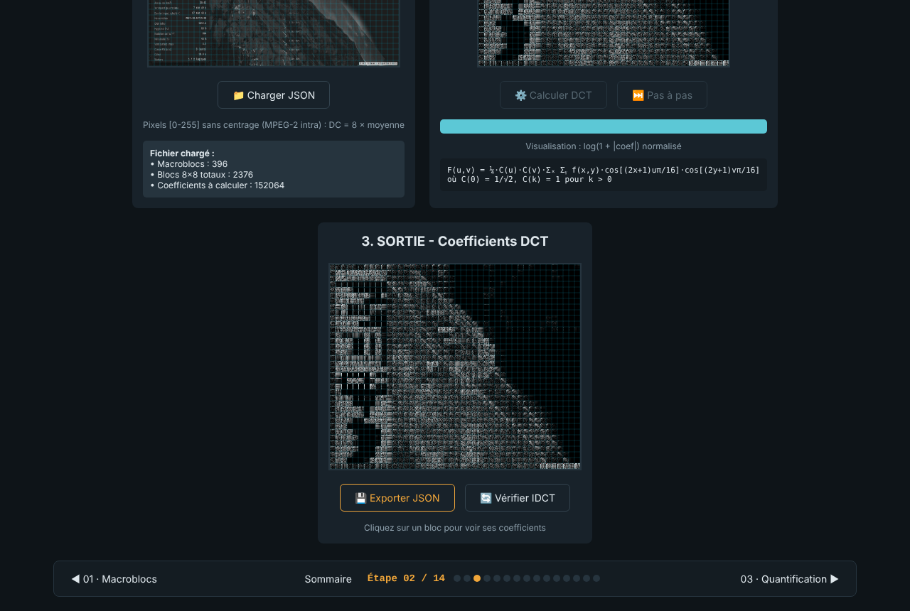

<!--
  Name     : README.md
  Purpose  : Overview of JPEG2DVB (step-by-step DVB-S transmission chain)
  Author   : Eric PERRET
  Date     : 2026-10-17
  License  : CC BY-NC 4.0
-->

# 📡 JPEG2DVB — from image to DVB-S modulation

🇫🇷 [Version française : LISEZMOI.md](LISEZMOI.md)

▶️ **[Home page of the 16 steps](https://ericperret.github.io/JPEG2DVB/index2.html)**

Interactive tutorial of the digital satellite TV chain: from capturing an image to shaping the QPSK signal, following MPEG-2 and DVB-S (EN 300 421). Each step is a standalone HTML page doing the real computations: it loads the file produced by the previous step (JSON or binary), processes it step by step with visualisation, and saves its result for the next step.

No library, no installation. User interfaces in French.

## The steps

| Step | Launch | Processing | Input → output | Screenshot |
|---|---|---|---|---|
| 00 | ▶️ [Camera](https://ericperret.github.io/JPEG2DVB/page00-camera.html) | Image capture from the webcam | webcam → image | [view](captures/page00-camera.png) |
| 01 | ▶️ [Macroblocks](https://ericperret.github.io/JPEG2DVB/page01-image-to-macroblocs.html) | RGB → YCbCr 4:2:0, 16×16 macroblocks (4 Y + 1 Cb + 1 Cr) | image → macroblock JSON | [view](captures/page01-image-to-macroblocs.png) |
| 02 | ▶️ [DCT](https://ericperret.github.io/JPEG2DVB/page02-dct.html) | 8×8 2D DCT, MPEG-2 intra (no centring, DC = 8 × mean), natural order F[v][u] | macroblocks → coefficients | [view](captures/page02-dct.png) |
| 03 | ▶️ [Quantisation](https://ericperret.github.io/JPEG2DVB/page03-quantification.html) | MPEG-2 quantisation: DC / 8, AC = 16·F / (W·quantiser_scale); matrix and scale code passed on to step 06 | coefficients → quantised integers | [view](captures/page03-quantification.png) |
| 04 | ▶️ [Zigzag](https://ericperret.github.io/JPEG2DVB/page04-zigzag.html) | Zigzag scan of the 64 coefficients | blocks → 64-value vectors | [view](captures/page04-zigzag.png) |
| 05 | ▶️ [RLE + Huffman](https://ericperret.github.io/JPEG2DVB/page05-rle-huffman.html) | (run, level) pairs, MPEG-2 tables B.12 / B.13 (DC) and B.14 (AC), escape, per-component DC predictors | vectors → bitstreams | [view](captures/page05-rle-huffman.png) |
| 06 | ▶️ [Elementary Stream](https://ericperret.github.io/JPEG2DVB/page06-elementary-stream.html) | MPEG-2 sequence, GOP, picture headers, slices; quantiser matrix and scale code from step 03; decodable by ffmpeg / VLC | bitstreams → .es file | [view](captures/page06-elementary-stream.png) |
| 07 | ▶️ [PES](https://ericperret.github.io/JPEG2DVB/page07-pes.html) | PES packets, PTS = initial PCR + 0.7 s (no DTS for an I picture), data alignment | ES → PES | [view](captures/page07-pes.png) |
| 08 | ▶️ [Transport Stream](https://ericperret.github.io/JPEG2DVB/page08-ts.html) | 188-byte packets, PAT and PMT tables, PCR in the first video packet | PES → .ts file, plays in VLC and ffplay | [view](captures/page08-ts.png) |
| 09 | ▶️ [PRBS](https://ericperret.github.io/JPEG2DVB/page09-prbs.html) | Energy dispersal, polynomial 1 + X¹⁴ + X¹⁵, 8-packet super-frame | TS → randomised TS | [view](captures/page09-prbs.png) |
| 10 | ▶️ [Reed-Solomon](https://ericperret.github.io/JPEG2DVB/page10-reed-solomon.html) | RS(204,188) shortened from RS(255,239), GF(2⁸) 0x11D, 8 correctable bytes | 188 → 204 bytes | [view](captures/page10-reed-solomon.png) |
| 11 | ▶️ [Interleaving](https://ericperret.github.io/JPEG2DVB/page11-interleaving.html) | Forney convolutional interleaver, I = 12, M = 17 | RS blocks → interleaved stream | [view](captures/page11-interleaving.png) |
| 12 | ▶️ [Convolutional coder](https://ericperret.github.io/JPEG2DVB/page12-convolutional_1.html) | K = 7, rate 1/2, G1 = 171₈, G2 = 133₈, optional puncturing | stream → coded bits | [view](captures/page12-convolutional_1.png) |
| 13 | ▶️ [QPSK](https://ericperret.github.io/JPEG2DVB/page13-qpsk.html) | 2 bits → I/Q symbol, Gray coding | bits → I/Q symbols | [view](captures/page13-qpsk.png) |
| 14 | ▶️ [SRRC filter](https://ericperret.github.io/JPEG2DVB/page14-srrc-v2.html) | Square-root raised-cosine pulse shaping | symbols → shaped signal | [view](captures/page14-srrc-v2.png) |
| 15 | ▶️ [Reception](https://ericperret.github.io/JPEG2DVB/page15-reception.html) | Reverse path: matched filter, Viterbi, deinterleaving, Reed-Solomon, derandomisation; byte-by-byte comparison with the step-08 TS | .cs16 signal → TS | [view](captures/page15-reception.png) |

## Usage

1. Open step 00 (webcam) or 01 (image file).
2. At each step, run the processing (at once or step by step), then click **next ▶**: the output is handed over to the next step, which loads it automatically (banner at the top of the page). Processing always stays a click.
3. The **Save** / **Load** buttons remain to keep every intermediate file or to resume from a file.

## Multi-picture stream (2.0)

To harden the algorithm before the FPGA port, the whole chain also processes a sequence of pictures.

1. **Step 01**: **Images** defaults to 25 (1 s of stream, adjustable from 1 to 1500), then ⚙️ Convert. The picture (or test pattern) is repeated with a moving square (+8 pixels per picture) and a 12-bit binary counter. Beyond one picture, outputs are binary `.j2d` containers (JSON header + typed arrays), loaded by the next steps like the JSON files.
2. **Step 02**: **fixed-point** option, integer DCT (13-bit coefficients, two passes, 32 bits are enough), bit-exact reference for the FPGA, within ±1 of the rounded floating-point DCT.
3. **Step 03**: TM5 rate control per slice (row of macroblocks). Symbol rate, FEC and video share of the multiplex give the target per picture; bits are counted exactly (VLC tables, headers, alignment); each slice's quantiser_scale_code is written in the stream.
4. **Steps 06 to 08**: sequence of I pictures (closed GOP of 12, repeated sequence header), one PES per picture, PTS = ((n+1)/25 + 0.1 s) × 90,000, constant-rate multiplex at the channel's useful bit rate (9.216 Mbit/s at 10 MS/s, FEC 1/2): PAT and PMT every 80 ms, PCR every 30 ms, null packets. Displayed checks: decoder buffer, arrival of each picture before its PTS, PCR and PSI intervals.
5. **Steps 09 to 14**: whole stream processed in blocks. Step 13: integer ±1 symbols. Step 14: SRRC filter (α = 0.35), optional 16-bit fixed-point coefficients, 16-bit integer I/Q (cs16 format) written to disk on the fly (Chrome, Edge) or downloaded at the end.

**Validation**: ffmpeg and ffprobe without warnings; bit rate measured on the PCRs is constant (9.215686 Mbit/s, error below one 27 MHz period); no continuity counter error. The step-14 baseband, demodulated by an independent DVB-S receiver (leandvb), gives back every received TS packet unchanged (6,351 of 6,367 for one second of stream, the others are lost while the receiver locks). File-by-file chain and next ▶ chain give identical outputs.

## History

| Version | Change |
|---|---|
| 2026-10-17 | Old SRRC filter removed (only v2 kept), pages renamed without copy suffix, header blocks, home page fixed, README / LISEZMOI rewritten, screenshot of every step |
| 2026-10-18 | AZS visual identity on the 15 steps and the home page (slate / amber / cyan palette, AZS mark linking back to www.azs.fr, system fonts); outputs checked identical along the whole chain; screenshots refreshed |
| 2026-10-18 | Pages 1.3: automatic hand-over between steps — next ▶ keeps the output in the browser (current session) and the next step loads it itself; processing stays manual; outputs identical to the file-by-file chain |
| 2026-10-18 | Pages 03, 04, 06 (1.4): boxed notes on the differences with MPEG-2 (separate DC quantisation, AC formula and quantiser_scale, alternate scan, matrices sent in zigzag order in the sequence header) |
| 2026-10-18 | MPEG-2 conformance (pages 02, 03, 05, 06 → 1.5): DCT without centring and in natural order (coefficients were transposed), normative quantisation, complete VLC tables B.12 / B.13 / B.14 with per-component DC predictors, quantiser matrix and scale code written in the stream. The elementary stream and the transport stream now decode with ffmpeg (35.7 dB PSNR at quality 50; 30.7 to 48.4 dB from quality 10 to 100). Pages 07–12 (1.4): JSON export of large streams fixed |
| 2026-10-18 | Pages 07 and 08 (1.5): ISO 13818-1 timing — PCR in the adaptation field of the first video packet (PID announced by the PMT), PTS = PCR + 0.7 s, data_alignment and random_access indicators, 33-bit PTS without 32-bit overflow |
| 2026-10-19 | Pages 2.0: multi-picture stream (.j2d container, fixed-point DCT, TM5 rate control, constant-rate multiplex, block processing, fixed-point SRRC written to disk on the fly). EN 300 421 conformance fixed in three steps: PRBS generator (initialisation and output), Reed-Solomon parity byte order, convolutional encoder register. Checked by demodulation with an independent DVB-S receiver |
| 2026-10-19 | Pages 2.1: version number shown in the navigation bar (read from the header block); step 14: 💾 Export I/Q .cs16 button (16-bit integers), for streams as for a single picture, direct write to disk as an option |
| 2026-10-19 | Step 15 (1.0): DVB-S reception in HTML/JS; the step-14 .cs16 gives back the step-08 TS byte for byte (6,367 packets out of 6,367 for 1 s of stream) |
| 2026-10-19 | Pages 01, 12, 14 (2.2): project presets — 25 pictures (1 s of stream), FEC 1/2, α = 0.35; the chain runs without touching any setting |

## License

CC BY-NC 4.0

## Author

**Eric PERRET** — [GitHub](https://github.com/ericperret)
